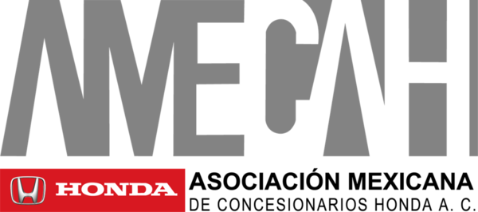

<p align="center">
  
</p>

<h1 align="center">AMECAH Soporte Remoto</h1>

<p align="center">
  Soporte remoto de la <b>Asociación Mexicana de Concesionarios Honda A.C.</b>, basado en
  <a href="https://github.com/rustdesk/rustdesk">RustDesk</a> · Licencia <a href="LICENCE">AGPL-3.0</a>
</p>

---

Este repositorio es un **fork de [RustDesk](https://github.com/rustdesk/rustdesk)** (versión
base `1.5.1`, commit upstream `1297da6d`, 24-oct-2026) adaptado para AMECAH. Funciona como
TeamViewer QuickSupport: el concesionario descarga un `.exe`, lo abre sin instalar nada,
le dicta al técnico su **ID** y su **contraseña de un solo uso**, y el técnico se conecta.
Todo el tráfico pasa por el servidor propio de AMECAH (`soporte.amecah.com.mx`), no por los
servidores públicos de RustDesk.

Se publica para cumplir con la licencia **GNU AGPL-3.0** de RustDesk (ver
[Licencia y cumplimiento](#licencia-y-cumplimiento-agpl-30)). El README original de RustDesk
está en [`README-rustdesk.md`](README-rustdesk.md).

## Componentes

```
Concesionario (AmecahSoporte.exe)          Técnico (Amecah.exe)
        │  solo recibe conexiones                  │  se conecta por ID + contraseña
        └──────────────► soporte.amecah.com.mx ◄───┘
                         hbbs (ID/rendezvous) 21115-21116
                         hbbr (relay)         21117
                         EC2 ARM (t4g) — repo de infraestructura rustdesk-infra
```

| Sabor | Archivo | Para quién | Comportamiento |
|---|---|---|---|
| **AmecahSoporte** | `AmecahSoporte-<ver>-x86_64.exe` | Concesionario / usuario final | Solo conexiones entrantes, sin instalación, sin ajustes, sin cuenta ni libreta de direcciones, contraseña temporal |
| **Amecah** | `Amecah-<ver>-x86_64.exe` | Técnicos de soporte | Cliente completo (entrante y saliente, se puede instalar) |

Ambos sabores tienen fijados el servidor y su clave pública (el usuario no puede cambiarlos),
desactivan la búsqueda de actualizaciones en rustdesk.com, el registro de dispositivo
(API de RustDesk Server Pro) y usan español por defecto.

El servidor es el [RustDesk Server](https://github.com/rustdesk/rustdesk-server) OSS
(`hbbs`/`hbbr`) **sin modificar**, desplegado con Terraform en una EC2 Graviton barata
(ver el repositorio `rustdesk-infra`).

## Cambios respecto a RustDesk

Regla del fork: los archivos de upstream se tocan lo mínimo; lo propio de AMECAH vive en
archivos nuevos. Al sincronizar con upstream, esta tabla es lo único que hay que revisar.

| Archivo | Tipo | Qué | Por qué |
|---|---|---|---|
| `src/amecah.rs` | nuevo | Configuración integrada: servidor, clave, nombre de la app y modo QuickSupport, leída de variables de entorno en tiempo de compilación | RustDesk solo acepta esta configuración desde un `custom.txt` firmado por RustDesk Ltd. |
| `src/common.rs` | modificado | `load_custom_client()` llama a `crate::amecah::load_builtin_config()`; el cuerpo de `read_custom_client()` posterior a la verificación de firma se movió a `apply_custom_client()` sin cambios | Reutilizar el mismo mecanismo de "custom client" de upstream sin la firma |
| `src/lib.rs` | modificado | `mod amecah;` | Registrar el módulo |
| `amecah/branding/` | nuevo | Icono y logos de AMECAH | Marca |
| `amecah/apply-branding.sh` | nuevo | Copia los iconos/logos sobre los de RustDesk **en el árbol de compilación** | No commitear binarios sobre archivos de upstream evita conflictos al sincronizar |
| `.github/workflows/amecah-windows.yml` | nuevo | Compila los dos sabores para Windows x64 y publica el release | Los workflows de upstream compilan todas las plataformas y dependen de secretos de RustDesk |
| `README.md`, `NOTICE.md` | nuevo / reemplazado | Este documento y avisos de licencia | Cumplimiento AGPL §5(a) |
| `README-rustdesk.md` | renombrado | README original de upstream, sin cambios | Conservar la documentación y los avisos originales |

## Compilar

### Variables de compilación

| Variable | Default | Descripción |
|---|---|---|
| `AMECAH_RENDEZVOUS_SERVER` | `soporte.amecah.com.mx` | Host de `hbbs`/`hbbr` |
| `AMECAH_RS_PUB_KEY` | — (obligatoria) | Contenido de `id_ed25519.pub` del servidor. Sin ella la conexión con el servidor no se autentica |
| `AMECAH_QUICK_SUPPORT` | vacío | `1` = sabor AmecahSoporte (QuickSupport) |
| `AMECAH_APP_NAME` | `AmecahSoporte` / `Amecah` en Windows | Nombre de la app. En macOS y Linux se conserva `RustDesk` salvo que se defina, porque ahí el nombre debe coincidir con el bundle `.app` y los paquetes |

### GitHub Actions (recomendado)

1. En *Settings → Secrets and variables → Actions → Variables* define
   `AMECAH_RS_PUB_KEY` (la imprime `terraform output` / `scripts/init-keys.sh` del repo de
   infraestructura) y, si cambia, `AMECAH_RENDEZVOUS_SERVER`.
2. Ejecuta el workflow **AMECAH Windows build** (manual), o crea un tag `amecah-vX.Y.Z`
   para que además publique un Release con los dos `.exe`:

   ```bash
   git tag amecah-v1.5.1-1 && git push origin amecah-v1.5.1-1
   ```

### Local

Mismos requisitos que upstream (Rust, vcpkg con `libvpx libyuv opus aom`, Flutter 3.24.5;
ver [`README-rustdesk.md`](README-rustdesk.md)):

```bash
git clone --recurse-submodules https://github.com/Amecah/rustdesk.git
cd rustdesk
bash amecah/apply-branding.sh
export AMECAH_RS_PUB_KEY="<id_ed25519.pub del servidor>"
export AMECAH_QUICK_SUPPORT=1          # omitir para el cliente de técnicos
python3 build.py --portable --flutter --hwcodec
```

### Firma de código

Los `.exe` salen **sin firmar**, así que Windows SmartScreen mostrará una advertencia. Para
distribuirlos a concesionarios conviene firmarlos con un certificado de firma de código de
AMECAH (p. ej. Azure Trusted Signing o un certificado OV/EV) en un paso extra del workflow.

## Sincronizar con upstream

```bash
git remote add upstream https://github.com/rustdesk/rustdesk.git   # una vez
git fetch upstream
git checkout master && git merge --ff-only upstream/master && git push origin master
git checkout amecah && git merge master        # resolver con la tabla de cambios
git submodule update --init --recursive
```

La rama `master` refleja upstream sin cambios; la rama `amecah` (por defecto) contiene la
personalización. Si hay conflicto en `README.md`, conserva la versión de AMECAH y lleva los
cambios de upstream a `README-rustdesk.md`.

## Licencia y cumplimiento (AGPL-3.0)

- **Licencia.** Este programa es software libre bajo la **GNU Affero General Public License
  v3.0** ([`LICENCE`](LICENCE)). Es una obra derivada de RustDesk, © RustDesk contributors /
  Purslane Tech Pte. Ltd., también AGPL-3.0. Las modificaciones de AMECAH (© 2026 Asociación Mexicana
  de Concesionarios Honda A.C.) se publican bajo la misma licencia. Ver [`NOTICE.md`](NOTICE.md).
- **Avisos de modificación (§5a).** Los cambios y su fecha están en
  [Cambios respecto a RustDesk](#cambios-respecto-a-rustdesk) y en el historial de git de la
  rama `amecah`. No se eliminaron avisos de copyright ni de licencia de upstream.
- **Código fuente correspondiente (§6).** Cada binario se publica en
  [Releases](https://github.com/Amecah/rustdesk/releases) junto al tag del que se compiló; el
  fuente completo de ese tag (incluido el submódulo `libs/hbb_common`, los scripts y el
  workflow de compilación) es el "Corresponding Source". **Si los `.exe` se distribuyen por
  otro medio** (sitio web, correo, USB), hay que acompañarlos de un enlace a este repositorio
  y al tag correspondiente, p. ej. en la página de descarga:
  *"AMECAH Soporte es software libre (AGPL-3.0) basado en RustDesk. Código fuente:
  https://github.com/Amecah/rustdesk"*.
- **Uso en red (§13).** El servidor `hbbs`/`hbbr` es RustDesk Server OSS sin modificar
  (fuente: https://github.com/rustdesk/rustdesk-server, AGPL-3.0). Si AMECAH lo modificara,
  debe publicar también ese código a quienes lo usen por la red.
- **Avisos legales en la interfaz.** No se ocultan los créditos de RustDesk ni la
  información de licencia de la ventana *Acerca de* (no se usa `hide-powered-by-me`).
- **Sin restricciones adicionales.** Quien reciba el binario puede usarlo, estudiarlo,
  modificarlo y redistribuirlo bajo la AGPL-3.0; no se le imponen términos adicionales.
- **Marcas (§7e).** "RustDesk" y su logo son marcas de sus titulares; este proyecto no está
  afiliado ni respaldado por RustDesk. Por eso el cliente usa otro nombre e iconos. El nombre
  y los logos de AMECAH y Honda en `amecah/branding/` son marcas de sus titulares; la AGPL no
  concede derechos sobre ellas, y quien redistribuya una versión modificada debe quitarlas.

## Contacto

Soporte técnico de AMECAH — https://amecah.com.mx
